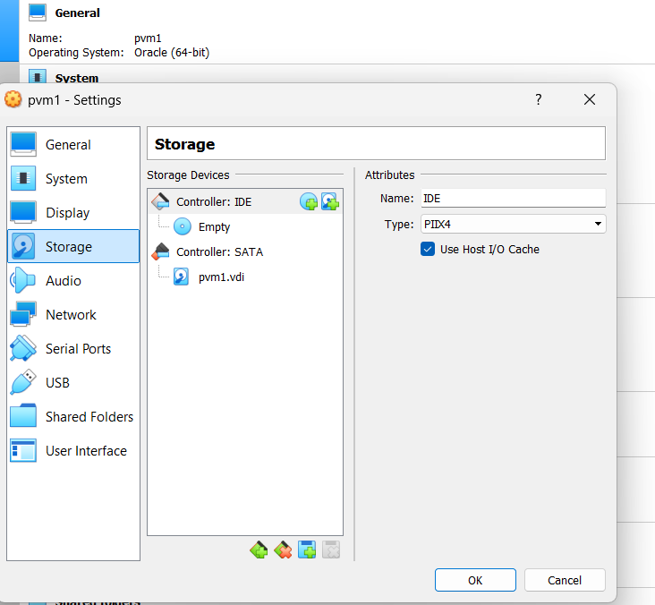
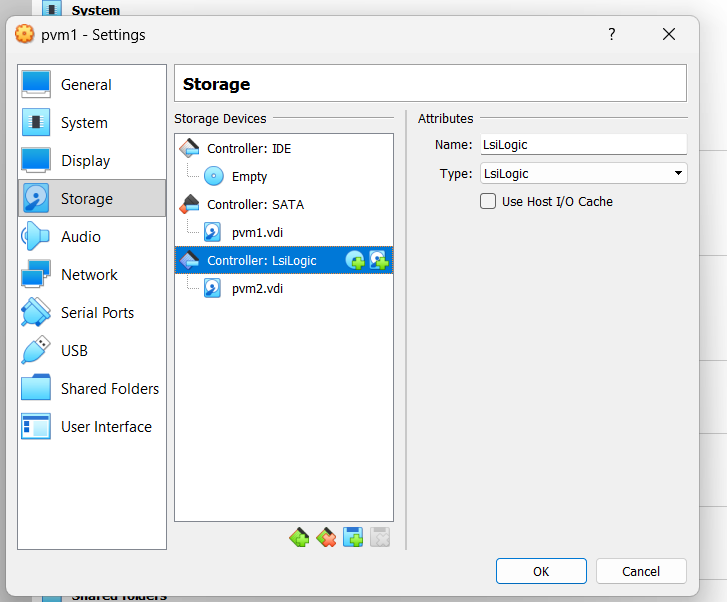

# Oracle 19c Enterprise Disaster Recovery & Multiplexing Simulation

## 📋 Project Overview
This project simulates an enterprise-grade database disaster recovery, storage redundancy, and multiplexing architecture using **Oracle Database 19c Enterprise Edition** on Oracle Linux. The core focus is eliminating Single Points of Failure (SPOF) by separating storage across physical disks (`/u02` and `/u03`), implementing robust RMAN backup hierarchies (Level 0 and Level 1), executing complex disaster simulations including Point-In-Time Recovery (PITR) and control file restoration, and configuring Automatic Storage Management (ASM).

---

## 1. 🎯 Project Objectives
◆ **Eliminate Single Points of Failure (SPOF):** Prove how disk multiplexing across separate block devices protects critical database control files and redo logs from hardware loss.

◆ **Master Enterprise Backup & Recovery:** Implement RMAN backup strategies and execute precise recovery workflows.

◆ **Simulate Real-World Disasters:** Handle missing storage paths, unmounted disks, missing control files, and perform precise Point-In-Time Recovery (PITR).

◆ **Explore Advanced Storage:** Transition from standard file system architectures to Oracle Automatic Storage Management (ASM).

---

## 2. ✅ **Key Concepts Covered**
◆ **Storage Redundancy & Multiplexing:** Mirroring online redo log members and archive log files across separate physical disks (`/u02` and `/u03`).

◆ **Database Operating Modes:** Transitioning from `NOARCHIVELOG` to `ARCHIVELOG` mode alongside Fast Recovery Area (FRA) configuration and sizing.

◆ **RMAN Backup Hierarchies:** Establishing common users, configuring backup permissions, and capturing incremental backups (Level 0 full baseline and Level 1 differential/cumulative).

◆ **Recovery Operations:** Using System Change Number (SCN) targets for Point-In-Time Recovery (PITR) and restoring lost control files.

◆ **Automatic Storage Management (ASM):** Provisioning and organizing ASM disk groups for enterprise storage virtualization.

---

## 3. 🗺️ Project Phases & Implementation Steps

### 3.1 Phase 1: Storage Architecture & Expansion
◆ Virtual Disk Provisioning & Mounting
- Attached a secondary virtual hard disk (pvm1_2.vdi) to the VirtualBox SCSI controller to establish storage redundancy and eliminate single points of failure (SPOFs).
- Upon boot, the raw block device (/sdb) was partitioned using GPT, formatted with the ext4 filesystem, and persistently mounted to /u03 via UUID configuration in /etc/fstab.

◆ Optimal Flexible Architecture (OFA) & Directory Layout Design
- Implemented a multi-disk storage topology separating primary database files, recovery areas, and secondary logging across independent physical virtual disks (/u02 and /u03).
- Established enterprise directory structures, including /u03/oradbcdb/fast_recovery_area for recovery management, /u02/oradbcdb/backups for backup storage, and /u02/oradbcdb/other_log_area to house multiplexed logging components.
- The complete terminal execution log for Phase 1 is available in the [Phase 1 Execution Log](https://github.com/Mubarak-Monsuru/oracle-multiplexing-and-disaster-recovery-simulation/blob/main/logs/p2_phase1.log).


**Figure 1:** VirtualBox storage configuration showing the initial single-disk (pvm1.vdi) baseline state.


**Figure 2:** VirtualBox storage configuration showing the attached secondary disk (pvm1_2.vdi) configured for storage-level SPOF elimination.

### 3.2 Phase 2: Logging & Recovery Foundations
◆ Enabling ARCHIVELOG Mode & Fast Recovery Area (FRA) Configuration
- Verified that Oracle Managed Files (OMF) is enabled to automate file naming and lifecycle management within the recovery destination.
- Configured the Fast Recovery Area size to 6G and DB_RECOVERY_FILE_DEST to the dedicated secondary mount point (/u03/oradbcdb/fast_recovery_area).
- Cycled the database instance to mount state and transitioned the database instance from NOARCHIVELOG to ARCHIVELOG mode.

◆ Multiplexed Online Redo Log Architecture
- Configured dual online redo log destinations using DB_CREATE_ONLINE_LOG_DEST_1 (/u03/...) and DB_CREATE_ONLINE_LOG_DEST_2 (/u02/...) to guarantee that mirrored redo log members reside on separate physical volumes.
- Resized and recreated redo log groups to 200MB members, ensuring robust transaction handling and fault tolerance.

◆ Multiplexing archive log destinations.
- Configured dual, simultaneous active archive log destinations to prevent logging bottlenecks or single points of failure during automated log switches.

```sql
ALTER SYSTEM SET LOG_ARCHIVE_DEST_1 = 'LOCATION=USE_DB_RECOVERY_FILE_DEST OPTIONAL' SCOPE=BOTH;

ALTER SYSTEM SET LOG_ARCHIVE_DEST_2 = 'LOCATION=/u02/oradbcdb/other_log_area OPTIONAL' SCOPE=BOTH;

ALTER SYSTEM SET LOG_ARCHIVE_DEST_STATE_1 = ENABLE SCOPE=BOTH;

ALTER SYSTEM SET LOG_ARCHIVE_DEST_STATE_2 = ENABLE SCOPE=BOTH;
```

- The complete terminal execution log for Phase 2 is available in the [Phase 2 Execution Log](https://github.com/Mubarak-Monsuru/oracle-multiplexing-and-disaster-recovery-simulation/blob/main/logs/p2_phase2.log).

### 3.3 Phase 3: Data Simulation & RMAN Backups
◆ Transactional Data Simulation (PDB2)
- Created an ENGINEERINGSTUDENTS table in PDB2 with a primary key generated using an identity column, starting at 226110 and incrementing by 10.
- Inserted four initial records and committed the transactions to establish the baseline dataset for backup and recovery testing.

◆ Dedicated RMAN Backup User & Level 0 Baseline Backup
- Created a common backup administration user (C##U1BCK) and granted CREATE SESSION and SYSBACKUP privileges across all containers to enable RMAN operations using dedicated backup credentials.
- Configured the RMAN retention policy to REDUNDANCY 1, customized the control file autobackup destination, and established an archive log deletion policy requiring at least one disk backup before deletion.
- Executed a database-wide Level 0 incremental backup using image copies, tagged WHOLE_LEVEL_0, alongside an archive log backup tagged ARCH_BKP. All backup files were directed to /u02/oradbcdb/backups.

```sql
CONFIGURE CONTROLFILE AUTOBACKUP FORMAT
FOR DEVICE TYPE DISK
TO '/u02/oradbcdb/backups/ctl_bk_%F';

CONFIGURE ARCHIVELOG DELETION POLICY
TO BACKED UP 1 TIMES TO DEVICE TYPE DISK;
```
The level 0 backup command:

```sql
RUN {
    BACKUP AS COPY INCREMENTAL LEVEL 0
    DATABASE
    TAG 'WHOLE_LEVEL_0'
    FORMAT '/u02/oradbcdb/backups/bkp_l0_%U';

    BACKUP ARCHIVELOG ALL
    TAG 'ARCH_BKP'
    FORMAT '/u02/oradbcdb/backups/arch_%U'
    DELETE ALL INPUT;
}
```
◆ Secondary DML Operations & Level 1 Incremental Backup
- Simulated additional transactional changes in PDB2 by inserting a fifth student record and updating an existing student's age. Committed the changes to generate new database activity.
- Executed a Level 1 incrementally updated backup using the existing Level 0 image copies as the baseline, applying the incremental backup strategy with the WHOLE_LEVEL_0 tag.
- Backed up newly generated archive logs and automatically deleted archived logs that had been successfully backed up.

```sql
RUN {
    RECOVER COPY OF DATABASE WITH TAG 'WHOLE_LEVEL_0';

    BACKUP INCREMENTAL LEVEL 1
    FOR RECOVER OF COPY
    WITH TAG 'WHOLE_LEVEL_0'
    FORMAT '/u02/oradbcdb/backups/bkp_l1_%U'
    DATABASE;

    BACKUP ARCHIVELOG ALL
    TAG 'ARCH_BKP'
    FORMAT '/u02/oradbcdb/backups/arch_%U'
    DELETE ALL INPUT;
}
```
◆ RMAN Backup Housekeeping & Retention Management
- Reviewed obsolete backups using REPORT OBSOLETE against the configured redundancy-based retention policy.
- Executed DELETE OBSOLETE to remove superseded backup pieces and reclaim storage space while retaining the backups required by the configured retention policy.
- The complete terminal execution log for Phase 3 is available in the [Phase 3 Execution Log](https://github.com/Mubarak-Monsuru/oracle-multiplexing-and-disaster-recovery-simulation/blob/main/logs/p2_phase3.log).

### 3.4 Phase 4: Disaster Simulation & Advanced Recovery

◆ **Simulating Physical Storage Failure & Establishing a Recovery Point**

- Captured the database's current SCN (`6955319`) and system timestamp (`16-NOV-2026 19:57:02`) to establish a precise recovery point before simulating data loss.
- Connected to PDB2 and deleted the `ENGINEERINGSTUDENTS` record for `Isa Danjuma`, then committed the transaction to simulate accidental data deletion.
- Demonstrated Oracle Flashback Query by querying the table using both the recorded SCN and timestamp, successfully retrieving the deleted record as it existed before the transaction.

```sql
SELECT *
FROM ENGINEERINGSTUDENTS AS OF SCN 6955319;

SELECT *
FROM ENGINEERINGSTUDENTS AS OF TIMESTAMP
TO_DATE('16-NOV-2026 19:57:02', 'DD-MON-YYYY HH24:MI:SS');
```

- Although Flashback Query provided a simpler means of retrieving the previous data, Tablespace Point-in-Time Recovery (TSPITR) was selected to demonstrate RMAN recovery capabilities and the importance of maintaining independent recovery resources.
- Shut down the database and unmounted the `/u03` filesystem to simulate the loss of the disk hosting one set of multiplexed online redo log members and one archive log destination.
- Recreated the FRA directory structure under `/u03` and assigned the required Oracle ownership and permissions, allowing the database instance to start while the original filesystem remained unavailable.
- Assessed storage requirements for TSPITR by checking the database datafile footprint, the size of the `PDB2:SLTBS` tablespace (200 MB), and the available space on the auxiliary destination.
- Created and configured the auxiliary recovery directory at `/u02/oradbcdb/aux`, ensuring sufficient space and appropriate ownership for RMAN's auxiliary instance.

◆ **Tablespace Point-in-Time Recovery (TSPITR)**

- Executed TSPITR as `SYS` using RMAN to recover the `SLTBS` tablespace in PDB2 to the previously recorded target SCN (`6955319`).
- Configured `/u02/oradbcdb/aux` as the auxiliary destination for RMAN's temporary recovery instance.

```sql
RECOVER TABLESPACE PDB2:SLTBS
UNTIL SCN 6955319
AUXILIARY DESTINATION '/u02/oradbcdb/aux';
```

- RMAN successfully created an auxiliary instance, restored the required datafiles and control file, applied the necessary incremental backups and archived redo logs, and completed the tablespace recovery.
- Verified the recovery by bringing `SLTBS` online and querying `ENGINEERINGSTUDENTS` in PDB2. All five student records, including the previously deleted `Isa Danjuma` record, were successfully restored.
- The exercise demonstrated how TSPITR can recover a specific tablespace to an earlier point without performing a complete database point-in-time recovery.

◆ **Post-Recovery Backup & Multiplexing Verification**

- Created a new database-wide Level 0 incremental backup using RMAN backup sets after the successful TSPITR operation. The backup included the database and archived redo logs, with backup files directed to `/u02/oradbcdb/backups`.

```sql
BACKUP AS BACKUPSET INCREMENTAL LEVEL 0
FORMAT '/u02/oradbcdb/backups/bkp_l0_%U'
TAG 'FULL_DB_BKP'
DATABASE PLUS ARCHIVELOG DELETE ALL INPUT;
```

- Executed `RESTORE DATABASE VALIDATE` to verify the readability and integrity of the available database backup files without performing an actual restore.
- Remounted the `/u03` filesystem and restarted the database, confirming that all pluggable databases opened successfully.
- Queried `V$LOGFILE` to verify that each online redo log group retained two members, with one member on `/u03` and its multiplexed counterpart on `/u02`.
- Executed multiple log switches and verified that both members were accessible on their respective storage locations.
- Queried `V$ARCHIVE_DEST` and confirmed that both archive log destinations (`DEST_ID` 1 and 2) reported `VALID`.
- Forced an archive log switch and queried `V$ARCHIVED_LOG` to confirm that archived redo logs were being generated simultaneously in both destinations.
- Performed RMAN crosschecks and backup housekeeping to reconcile backup records with the files available on disk. Also executed a subsequent Level 1 incremental backup tagged `FULL_L1_DB`.

◆ **Simulating Control File Loss & Performing Database Recovery**

- Queried `V$DATABASE` configuration to identify the multiplexed control file locations, then simulated complete control file loss by manually deleting both control files.
- Aborted the instance and restarted it in `NOMOUNT` mode because the database could no longer mount without a valid control file.
- Used RMAN to restore the control file from its dedicated autobackup, mount the database, restore the database datafiles, and apply the available archived redo logs.

```sql
RUN {
    RESTORE CONTROLFILE
    FROM '/u02/oradbcdb/backups/ctl_bk_c-2274470866-20261116-02';

    ALTER DATABASE MOUNT;

    RESTORE DATABASE;

    RECOVER DATABASE;
}
```

- After successful media recovery, opened the database using `RESETLOGS` and verified that PDB1 and PDB2 opened successfully.
- Queried `PDB2.ENGINEERINGSTUDENTS` and confirmed that all five records remained available after the database recovery.
- Performed additional RMAN crosschecks and removed expired backup records and obsolete datafile copies resulting from the recovery and backup housekeeping operations.
- Finally, used ADRCI with `PURGE -AGE 1440` to purge diagnostic data older than 24 hours.

- The complete terminal execution log for Phase 4 is available in the [Phase 4 Execution Log](https://github.com/Mubarak-Monsuru/oracle-multiplexing-and-disaster-recovery-simulation/blob/main/logs/p2_phase4.log).