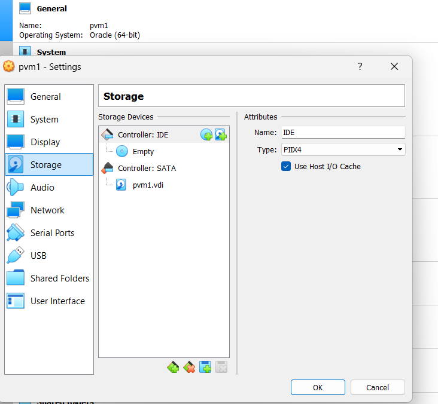
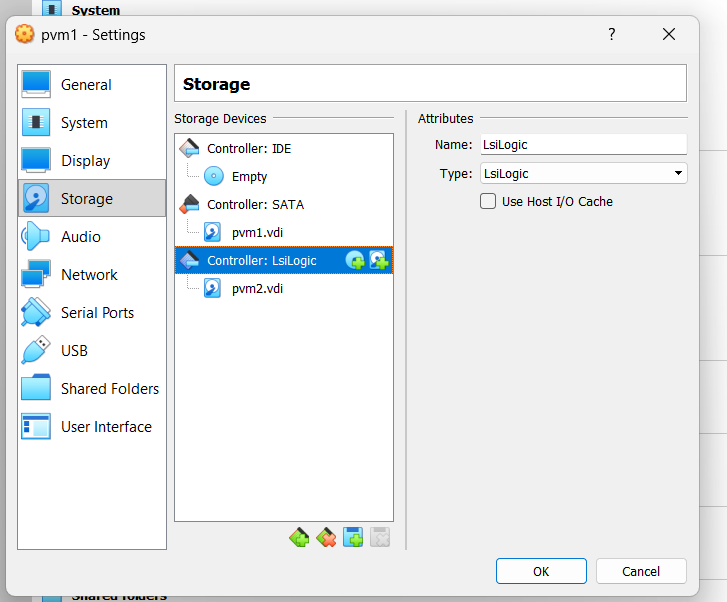

# Oracle 19c Enterprise Disaster Recovery & Multiplexing Simulation

## 📋 Project Overview
This project simulates an enterprise-grade database disaster recovery, storage redundancy, and multiplexing architecture using **Oracle Database 19c Enterprise Edition** on Oracle Linux. The core focus is eliminating Single Points of Failure (SPOF) by separating storage across physical disks (`/u02` and `/u03`), implementing robust RMAN backup hierarchies (Level 0 and Level 1), executing complex disaster simulations including Point-In-Time Recovery (PITR) and control file restoration, and configuring Automatic Storage Management (ASM).

---

## 1. 🎯 Project Objectives
◆ **Eliminate Single Points of Failure (SPOF):** Prove how disk multiplexing across separate block devices protects critical database control files and redo logs from hardware loss.

◆ **Master Enterprise Backup & Recovery:** Implement RMAN backup strategies and execute precise recovery workflows.

◆ **Simulate Real-World Disasters:** Handle missing storage paths, unmounted disks, missing control files, and perform precise Point-In-Time Recovery (PITR).

◆ **Explore Advanced Storage:** Transition from standard file system architectures to Oracle Automatic Storage Management (ASM).

---

## 2. ✅ **Key Concepts Covered**
◆ **Storage Redundancy & Multiplexing:** Mirroring online redo log members and archive log files across separate physical disks (`/u02` and `/u03`).

◆ **Database Operating Modes:** Transitioning from `NOARCHIVELOG` to `ARCHIVELOG` mode alongside Fast Recovery Area (FRA) configuration and sizing.

◆ **RMAN Backup Hierarchies:** Establishing common users, configuring backup permissions, and capturing incremental backups (Level 0 full baseline and Level 1 differential/cumulative).

◆ **Recovery Operations:** Using System Change Number (SCN) targets for Point-In-Time Recovery (PITR) and restoring lost control files.

◆ **Automatic Storage Management (ASM):** Provisioning and organizing ASM disk groups for enterprise storage virtualization.

---

## 3. 🗺️ Project Phases & Implementation Steps

### 3.1 Phase 1: Storage Architecture & Expansion
◆ Virtual Disk Provisioning & Mounting
- Attached a secondary virtual hard disk (pvm1_2.vdi) to the VirtualBox SCSI controller to establish storage redundancy and eliminate single points of failure (SPOFs).
- Upon boot, the raw block device (/sdb) was partitioned using GPT, formatted with the ext4 filesystem, and persistently mounted to /u03 via UUID configuration in /etc/fstab.

◆ Optimal Flexible Architecture (OFA) & Directory Layout Design
- Implemented a multi-disk storage topology separating primary database files, recovery areas, and secondary logging across independent physical virtual disks (/u02 and /u03).
- Established enterprise directory structures, including /u03/oradbcdb/fast_recovery_area for recovery management, /u02/oradbcdb/backups for backup storage, and /u02/oradbcdb/other_log_area to house multiplexed logging components.
- The complete terminal execution log for Phase 1 is available in the [Phase 1 Execution Log](https://github.com/Mubarak-Monsuru/oracle-multiplexing-and-disaster-recovery-simulation/blob/main/logs/p2_phase1.log).

**Figure 1:** VirtualBox storage configuration showing the initial single-disk (pvm1.vdi) baseline state.

**Figure 2:** VirtualBox storage configuration showing the attached secondary disk (pvm1_2.vdi) configured for storage-level SPOF elimination.

### 3.2 Phase 2: Logging & Recovery Foundations
◆ Enabling ARCHIVELOG Mode & Fast Recovery Area (FRA) Configuration
- Verified that Oracle Managed Files (OMF) is enabled to automate file naming and lifecycle management within the recovery destination.
- Configured the Fast Recovery Area size to 6G and DB_RECOVERY_FILE_DEST to the dedicated secondary mount point (/u03/oradbcdb/fast_recovery_area).
- Cycled the database instance to mount state and transitioned the database instance from NOARCHIVELOG to ARCHIVELOG mode.

◆ Multiplexed Online Redo Log Architecture
- Configured dual online redo log destinations using DB_CREATE_ONLINE_LOG_DEST_1 (/u03/...) and DB_CREATE_ONLINE_LOG_DEST_2 (/u02/...) to guarantee that mirrored redo log members reside on separate physical volumes.
- Resized and recreated redo log groups to 200MB members, ensuring robust transaction handling and fault tolerance.

◆ Multiplexing archive log destinations.
- Configured dual, simultaneous active archive log destinations to prevent logging bottlenecks or single points of failure during automated log switches.

ALTER SYSTEM SET LOG_ARCHIVE_DEST_1 = 'LOCATION=USE_DB_RECOVERY_FILE_DEST OPTIONAL' SCOPE=BOTH;

ALTER SYSTEM SET LOG_ARCHIVE_DEST_2 = 'LOCATION=/u02/oradbcdb/other_log_area OPTIONAL' SCOPE=BOTH;

ALTER SYSTEM SET LOG_ARCHIVE_DEST_STATE_1 = ENABLE SCOPE=BOTH;

ALTER SYSTEM SET LOG_ARCHIVE_DEST_STATE_2 = ENABLE SCOPE=BOTH;

- The complete terminal execution log for Phase 2 is available in the [Phase 2 Execution Log](https://github.com/Mubarak-Monsuru/oracle-multiplexing-and-disaster-recovery-simulation/blob/main/logs/p2_phase2.log).

### Phase 3: Data Simulation & RMAN Backups
* Creating a test table on `PDB2` and executing initial transactional DML inserts.
* Creating a dedicated common user to manage backups and taking a Level 0 baseline backup (database + archive logs).
* Performing secondary DML changes and capturing a Level 1 incremental backup.

### Phase 4: Disaster Simulation & Advanced Recovery
* Simulating physical storage failure by committing transactions and unmounting the `/u03` disk.
* Performing a Point-In-Time Recovery (PITR) to restore data back to a precise target SCN.
* Simulating control file loss, remounting `/u03`, and executing control file recovery.

### Phase 5: Modern Storage Virtualization
* Provisioning and configuring Oracle Automatic Storage Management (ASM) storage pools.

---

## 📦 Project Deliverables
* **GitHub Repository Documentation:** A professional technical README documenting each architecture phase, command outputs, and validation queries.
* **RMAN Recovery Playbook:** Step-by-step scripts and notes covering Level 0/Level 1 backups, PITR, and control file restoration workflows.
* **Disaster Simulation Log:** A record of failure simulations (unmounting `/u03`, dropping control files) and the exact recovery syntax used to restore service.
* **ASM Configuration Report:** Summary notes and validation checks from implementing ASM storage management.